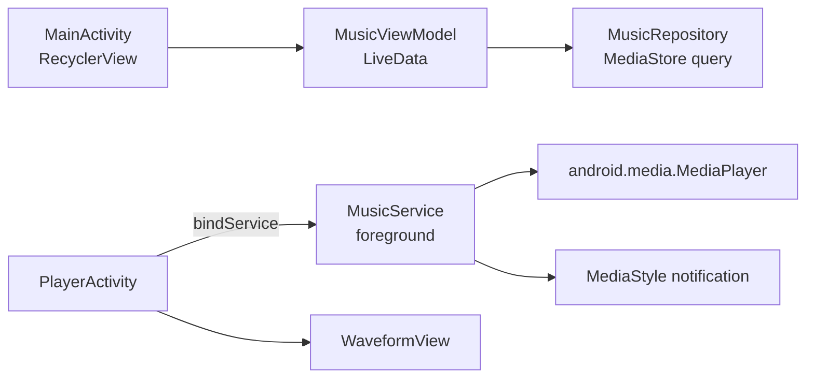

# MediaPlayer

   

A local music player with a polished, album-art-driven look: a splash screen, a song list read from the device, and a player screen with a **blurred album-art background**, a circular seek bar and an animated waveform. Playback runs in a **bound foreground service**, so music keeps going when you leave the app.

## Features

- **Device library** — songs read from `MediaStore`, filtered to real music (`IS_MUSIC != 0`) with album art
- **Foreground `MusicService`** bound to the UI, with a `MediaStyle` notification
- **Player screen** with blurred album art (Coil `BlurTransformation`), circular seek bar and next / previous
- **Custom `WaveformView`** — bars drawn directly on a `Canvas`, animating while music plays
- **MVVM** — `MusicViewModel` exposes the song list, current song and play state as `LiveData` from a `MusicRepository`
- **Lottie** animation on the splash screen
- A **Jetpack Compose** version of the player screen (`PlayerScreen.kt`) as a UI experiment

## How it works

### Service binding
The activity binds to `MusicService` and gets the instance back through its binder (`currentService()`), so the UI can call `playPause()` or `createMediaPlayer(position)` directly while the service owns the `MediaPlayer` and stays alive in the foreground.

### Waveform
`WaveformView` keeps an array of bar amplitudes. While playing, every frame assigns new random heights and calls `invalidate()`; when paused, the bars collapse to a flat line. It's a lightweight visual effect without decoding any audio.

## Architecture



## Project structure

```
com.example.mediaplayer
├── MainActivity.kt
├── PlayerActivity.kt
├── PlayerScreen.kt
├── SplashActivity.kt
├── adapter/
│   ├── MusicAdapter.kt
├── model/
│   ├── Music.kt
├── repository/
│   ├── MusicRepository.kt
├── service/
│   ├── MusicService.kt
├── view/
│   ├── WaveformView.kt
├── viewmodel/
│   ├── MusicViewModel.kt
```

<sub>10 source files · 559 lines of code · 4 layouts</sub>

## Tech stack

| | |
|---|---|
| **Language** | Kotlin |
| **UI** | Jetpack Compose + XML layouts, View Binding |
| **Min / Target SDK** | 24 / 34 |
| **Media3 ExoPlayer** | Audio playback |
| **Coil** | Image loading |
| **Lottie** | Animations |
| **Navigation component** | Screen navigation |
| **ViewModel** | UI state |
| **LiveData** | Observable data |

## Getting started

```bash
git clone https://github.com/rajabbov/MediaPlayer.git
```

1. Open the folder in **Android Studio** (Ladybug or newer).
2. Let Gradle sync.
3. Complete the configuration below, then run the `app` configuration.

### Configuration

On Android 13+ the app asks for `READ_MEDIA_AUDIO`; on older versions, `READ_EXTERNAL_STORAGE`.

## Known limitations

- Notification buttons are drawn but not yet connected to `PendingIntent`s.
- The Compose `PlayerScreen` is a visual prototype; its buttons are not wired to playback.
- Media3 is declared as a dependency but playback still uses the platform `MediaPlayer`.

---

Made by **Ibrohimjon Rajabboyev** · [@rajabbov](https://github.com/rajabbov)
